<!-- ───────────── HEADER ───────────── -->
<p align="center">
  
</p>

<p align="center">
  <a href="https://git.io/typing-svg">
    
  </a>
</p>

<p align="center">
  
  
  
</p>

---

### 🌌 About me

```csharp
public class Juha : Developer
{
    public string Location   => "Finland";
    public string[] Builds   => new[] { "games", "mobile apps", "AI experiments" };
    public string[] Engines  => new[] { "Unity", "Unreal Engine", "Flutter" };
    public string[] Stack    => new[] { "C#", "C++", "Kotlin", "JavaScript", "React", "Node.js" };
    public string Status     => "always building something new";

    public void SayHi() => Console.WriteLine("Moi! Thanks for stopping by 👋");
}
```

- 🎮 I build **games** and love turning ideas into playable prototypes
- 📱 I make **mobile apps** with Android Studio and Flutter
- 🤖 I'm into **AI & automation**, from voice assistants to smart mirrors
- 🪞 Built [**MagicMirror**](https://github.com/JuhaP2/MagicMirror) modules that read ChatGPT answers aloud
- 🛠️ I enjoy contributing to open source

### 🧪 Things I've made for you

| Project | What it does |
| --- | --- |
| 🧱 [**Contribution Tetris**](https://github.com/JuhaP2/contribution-tetris) | A real game of Tetris built from your GitHub contributions, like the one below |
| 🌌 [**Aurora Banner**](https://juhap2.github.io/aurora-banner/) | Make an animated northern-lights banner like mine in 30 seconds |

---

### 🧰 Tech stack

<p align="center">
  <a href="https://skillicons.dev">
    
    <br />
    
  </a>
</p>

---

### 📈 Activity

<p align="center">
  
</p>

<p align="center">
  <picture>
    <source media="(prefers-color-scheme: dark)" srcset="https://raw.githubusercontent.com/JuhaP2/JuhaP2/output/tetris-dark.svg" />
    <source media="(prefers-color-scheme: light)" srcset="https://raw.githubusercontent.com/JuhaP2/JuhaP2/output/tetris-light.svg" />
    
  </picture>
</p>

---

### 📫 Get in touch

<p align="center">
  <a href="mailto:juha.pulkkaa@gmail.com"></a>
  <a href="https://github.com/JuhaP2?tab=repositories"></a>
</p>

<p align="center">⭐ If you find something useful here, a star is always appreciated!</p>

<!-- ───────────── FOOTER ───────────── -->
<p align="center">
  
</p>
