<!-- ───────────── HEADER ───────────── -->
<p align="center">
  
</p>

<p align="center">
  <a href="https://git.io/typing-svg">
    
  </a>
</p>

<p align="center">
  
  
  
</p>

---

### 🌌 About me

```lua
local Juha = {
    name       = "Juha Pulkka",
    location   = "Finland 🇫🇮",
    builds     = { "games", "RedM scripts", "mobile apps", "AI experiments" },
    engines    = { "Unity", "Unreal Engine", "Flutter" },
    frameworks = { "VORP (RedM)", "React", "Node.js" },
    status     = "always building something new",
}

function Juha:sayHi()
    print("Moi! Thanks for stopping by 👋")
end
```

- 🎮 I build **games** and love turning ideas into playable prototypes
- 🤠 I write **RedM** resources for the VORP framework: skills, jobs, recoil and secret doors
- 📱 I make **mobile apps** with Android Studio and Flutter
- 🤖 I'm into **AI & automation**, from voice assistants to smart mirrors
- 🛠️ I contribute to open source, like [**VORP Core**](https://github.com/VORPCORE/vorp_core)

---

### 🚀 Featured projects

| Project | What it is |
| --- | --- |
| 🧭 [**Perry_XP**](https://github.com/JuhaP2/Perry_XP) | RuneScape-style 1–99 skill system for RedM with 10 skills and an XP API |
| 🚪 [**Perry_Trapdoors**](https://github.com/JuhaP2/Perry_Trapdoors) | Animated, synced secret doors and trapdoors for RedM |
| 🔫 [**Perry_Recoil**](https://github.com/JuhaP2/Perry_Recoil) | Realistic per-weapon recoil and aim sway for RedM |
| 🥃 [**Saloon**](https://github.com/JuhaP2/Saloon) | Complete saloon job: serving, billing, boss menu and storage |
| 🪞 [**MagicMirror**](https://github.com/JuhaP2/MagicMirror) | MagicMirror² modules: ChatGPT answers read aloud with text-to-speech |

---

### 🧰 Tech stack

<p align="center">
  <a href="https://skillicons.dev">
    
    <br />
    
  </a>
</p>

---

### 📈 Activity

<p align="center">
  
</p>

<p align="center">
  <picture>
    <source media="(prefers-color-scheme: dark)" srcset="https://raw.githubusercontent.com/JuhaP2/JuhaP2/output/snake-dark.svg" />
    <source media="(prefers-color-scheme: light)" srcset="https://raw.githubusercontent.com/JuhaP2/JuhaP2/output/snake-light.svg" />
    
  </picture>
</p>

---

### 📫 Get in touch

<p align="center">
  <a href="mailto:juha.pulkkaa@gmail.com"></a>
  <a href="https://github.com/JuhaP2?tab=repositories"></a>
</p>

<p align="center">⭐ If you find something useful here, a star is always appreciated!</p>

<!-- ───────────── FOOTER ───────────── -->
<p align="center">
  
</p>
